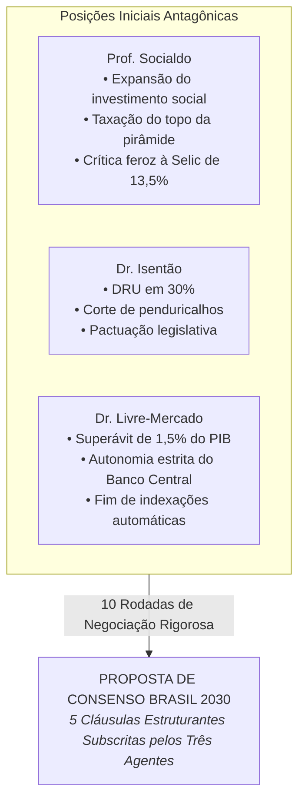

# Grande Debate Econômico Nacional — Brasil 2030

O debate econômico colocou frente a frente três vertentes essenciais do pensamento brasileiro para resolver o dilema histórico: **como garantir equilíbrio fiscal duradouro, baixar os juros reais e controlar a dívida pública sem estrangular os investimentos em infraestrutura e a rede de proteção social aos mais vulneráveis?**

---

## O Desafio Estrutural Discutido

No início das 10 rodadas, o Brasil apresentava:
- **Dívida Bruta do Governo Geral (DBGG):** ~82,9% do PIB, com projeções inerciais de pico em até 89,7%.
- **Custo do Serviço da Dívida:** Cerca de R$ 107,5 bilhões mensais pagos exclusivamente em juros nominais.
- **Taxa Selic Nominal:** No patamar restritivo de ~13,50% ao ano, onerando o crédito produtivo e o crediário familiar.
- **Renúncias Fiscais e Penduricalhos:** Mais de R$ 100 bilhões anuais concedidos em benefícios tributários a setores favorecidos e supersalários na cúpula do serviço público.

---

## Os Três Caminhos que Convergiram

---

## Navegue pelo Debate

-   :material-file-document-check:{ .lg .middle } **Proposta de Consenso Econômico**

    ---

    Leia as 5 cláusulas oficiais ratificadas pelos debatedores: meta de inflação em 3,0%, redução da Selic para 7,5%-8,5%, corte de R$ 110 bi em renúncias, blindagem do Bolsa Família e piso para obras públicas.

    [:octicons-arrow-right-24: Acessar Termo de Consenso](consenso.md)

-   :material-forum:{ .lg .middle } **Transcrição Integral das 10 Rodadas**

    ---

    Acompanhe o embate argumento por argumento: desde o choque inicial na Fase de Diagnóstico até a pactuação cirúrgica das concessões mútuas na reta final.

    [:octicons-arrow-right-24: Ler Debate Completo](debate.md)

