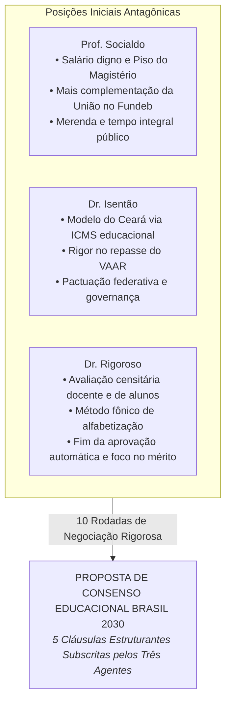

# Grande Debate Educacional Nacional — Brasil 2030

O debate sobre educação reuniu os agentes em torno do maior desafio do capital humano brasileiro: **como garantir que cada criança aprenda a ler e calcular na idade certa, erradicar o analfabetismo funcional e elevar a pontuação do país no ranking global do PISA (OCDE), preservando a valorização docente e a equidade federativa?**

---

## O Desafio Estrutural Discutido

No início das 10 rodadas, os debatedores analisaram dados alarmantes:
- **Alfabetização na Idade Certa:** 44% das crianças chegam ao final do 3º ano do Ensino Fundamental sem saber ler ou interpretar um texto básico.
- **Desempenho Internacional (PISA):** O Brasil amarga a 65ª posição entre 81 países em proficiência matemática, com média de 379 pontos.
- **Evasão no Ensino Médio:** Cerca de 14% de abandono acumulado, com jovens forçados a abandonar as salas de aula para complementar a renda familiar.
- **Desigualdade Federativa:** Municípios com orçamentos frágeis sofrendo para cumprir o Piso Nacional do Magistério e manter escolas com conectividade e saneamento básico.

---

## Os Três Caminhos que Convergiram

---

## Navegue pelo Debate

-   :material-file-document-check:{ .lg .middle } **Proposta de Consenso Educacional**

    ---

    Leia as 5 cláusulas oficiais ratificadas pelos debatedores: meta de alfabetização acima de 80%, salto no PISA para 420 pontos, evasão abaixo de 5%, ampliação do programa Pé-de-Meia, reajuste do PNAE pela inflação de alimentos e FUST para conectividade de 100% das escolas.

    [:octicons-arrow-right-24: Acessar Termo de Consenso](consenso.md)

-   :material-forum:{ .lg .middle } **Transcrição Integral das 10 Rodadas**

    ---

    Acompanhe o debate minucioso sobre Fundeb (VAAT e VAAR), método fônico, modelos do Ceará e Sobral, bonificação por desempenho e condições de trabalho docente.

    [:octicons-arrow-right-24: Ler Debate Completo](debate.md)

