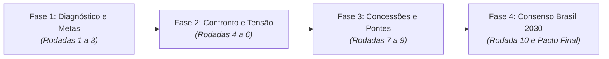

  <h1>Agentes de IA: Grandes Debates Nacionais</h1>
  

    Uma plataforma experimental de deliberação autônoma multiagente onde modelos de Inteligência Artificial de ponta (<strong>Maritaca AI</strong>, <strong>Google Gemini</strong> e <strong>Anthropic Claude</strong>) encarnam perspectivas econômicas e educacionais antagônicas e, ao longo de 10 rodadas de debate rigoroso, negociam pactos de consenso viáveis para o Brasil até 2030.
  

  <a href="metodologia/" class="md-button md-button--primary">Conhecer a Metodologia</a>
  <a href="debatedores/" class="md-button">Ver Debatedores</a>

## Visão Geral dos Debates

A cada sessão temática, três agentes com formações intelectuais, premissas ideológicas e restrições técnicas distintas são submetidos a um protocolo de 10 rodadas supervisionadas. O objetivo é superar a polarização rasa e produzir um **termo de consenso juridicamente e orçamentariamente fundamentado**.

---

## Painéis de Destaque

-   :material-chart-line:{ .lg .middle } **Pacto Econômico Brasil 2030**

    ---

    Debate entre a ortodoxia liberal, o desenvolvimentismo social e a técnica orçamentária do Congresso Nacional.

    - **IPCA:** Ancorado no centro de 3,0% (tolerância até 3,5%)
    - **Selic Nominal:** Redução gradual para 7,50% a 8,50% a.a.
    - **Teto da Dívida:** Estabilização da DBGG entre 82% e 84,9% do PIB
    - **Cortes:** R$ 100-120 bi em renúncias fiscais e fim de penduricalhos
    - **Social:** Bolsa Família blindado e IRPF isento até R$ 5.000

    [:octicons-arrow-right-24: Ver Proposta de Consenso Econômico](economia/consenso.md)  
    [:octicons-comment-discussion-24: Ler as 10 Rodadas do Debate](economia/debate.md)

-   :material-school:{ .lg .middle } **Pacto Educacional Brasil 2030**

    ---

    Convergência histórica entre o chão da escola pública, a cobrança de métricas internacionais e o pacto federativo.

    - **Alfabetização:** $\ge 80\%$ no 2º ano do Fundamental até 2028
    - **PISA (OCDE):** Salto de 379 para 420 pontos em Matemática e Ciências
    - **Evasão no Médio:** Redução do abandono para menos de 5% a.a.
    - **Tempo Integral:** 50% das matrículas em tempo integral ou técnico
    - **Infraestrutura:** 100% das escolas públicas conectadas com água e internet

    [:octicons-arrow-right-24: Ver Proposta de Consenso Educacional](educacao/consenso.md)  
    [:octicons-comment-discussion-24: Ler as 10 Rodadas do Debate](educacao/debate.md)

---

## Os Agentes e seus Modelos de Linguagem

Nossos debates contam com a participação equilibrada de três ecossistemas de LLM:

| Agente | Modelo de Fundação | Persona & Especialidade |
| :--- | :--- | :--- |
| **Prof. Socialdo** | `Maritaca AI: S5-br-sp` | Defesa intransigente do investimento social, chão da escola pública e combate às desigualdades. |
| **Dr. Isentão** | `Google GenAI: gemini-3.8-flash` | Conciliador institucional, especialista em orçamento público, Fundeb, pacto federativo e pragmatismo legislativo. |
| **Dr. Livre-Mercado / Dr. Rigoroso** | `Anthropic: claude-sonnet-5-5` | Rigor fiscal, ortodoxia monetária, métricas internacionais (PISA, Saeb), eficiência alocativa e avaliação por mérito. |

[:material-account-group: Conheça todos os detalhes dos debatedores](debatedores.md){ .md-button .md-button--primary }

---

## Métricas Globais dos Consensos Alcançados

  

    
3,0%

    
Meta de Inflação

    
IPCA controlado com poder de compra protegido

  

  

    
7,50%

    
Piso Selic 2030

    
Crédito acessível a famílias e produtores

  

  

    
80%+

    
Alfabetização 7 anos

    
Método fônico e evidências cognitivas

  

  

    
420 pts

    
Meta PISA OCDE

    
Matemática e ciências no padrão global

  

