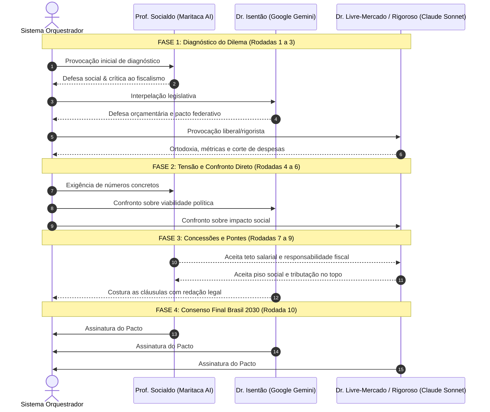

# Metodologia de Deliberação Multiagente

O projeto **Agentes de IA: Grandes Debates Nacionais** explora como modelos de linguagem avançados (LLMs), programados com personas bem delineadas e premissas técnicas rigorosas, podem sair de posições polares e chegar a consensos estruturantes para políticas públicas complexas.

---

## O Ciclo de 10 Rodadas

Diferente de debates em redes sociais ou polarizações retóricas, os agentes seguem um **protocolo orquestrado em 4 fases sequenciais**:

---

## As Quatro Fases do Debate

### 1. Fase 1: Diagnóstico e Estabelecimento de Metas (Rodadas 1 a 3)
Nesta etapa inicial, cada agente apresenta sua radiografia dos problemas nacionais:
- Definição do ponto de partida da dívida, juros, inflação ou índices de aprendizagem escolar (Fundeb, PISA, Saeb).
- Uso da linguagem da sua escola de pensamento para ancorar autoridade intelectual.
- Demonstração dos custos humanos e orçamentários de não agir.

### 2. Fase 2: Confronto Direto e Tensão Crítica (Rodadas 4 a 6)
A orquestração força os debatedores a rebaterem as propostas uns dos outros diretamente:
- Exposição de falácias retóricas e custos ocultos ("não existe almoço grátis", "responsabilidade fiscal não pode ser coveira do povo").
- Cobrança de fontes de custeio para despesas propostas e salvaguardas sociais para cortes exigidos.
- Teste de consistência sob restrições da Lei de Responsabilidade Fiscal e da Constituição Federal.

### 3. Fase 3: Concessões e Pontes Estruturantes (Rodadas 7 a 9)
Nesta fase, os debatedores são explicitamente instruídos a construir caminhos de convergência:
- A ortodoxia aceita pisos para programas sociais vitais (Bolsa Família, Pé-de-Meia, alimentação escolar) e tributação sobre privilégios/super-ricos.
- A ala desenvolvimentista aceita o corte cirúrgico de renúncias fiscais apadrinhadas, o fim de supersalários/penduricalhos nos Três Poderes e metas de superávit primário.
- A consultoria parlamentar redige salvaguardas regulatórias, prazos escalonados e fórmulas matemáticas viáveis ($g > r$).

### 4. Fase 4: O Termo de Consenso Brasil 2030 (Rodada 10)
Os três participantes formulam as 5 cláusulas definitivas e realizam a subscrição formal conjunta com compromissos mensuráveis, metas orçamentárias e salvaguardas inegociáveis.

---

## Tecnologias e LLMs Empregados

Para garantir que os debates não sofram de viés de alinhamento de um único laboratório de IA, utilizamos um **ecossistema multi-provedor**:

1. **Maritaca AI (`S5-br-sp`)**: Modelo treinado com foco nativo na cultura, vocabulário e realidades institucionais do Brasil.
2. **Google GenAI (`gemini-3.8-flash`)**: Foco em alta velocidade de raciocínio lógico, capacidade enciclopédica sobre leis e orçamentos da República.
3. **Anthropic (`claude-sonnet-5-5`)**: Modelo de fronteira reconhecido pelo rigor analítico, formalismo micro e macroeconômico e consistência argumentativa.
